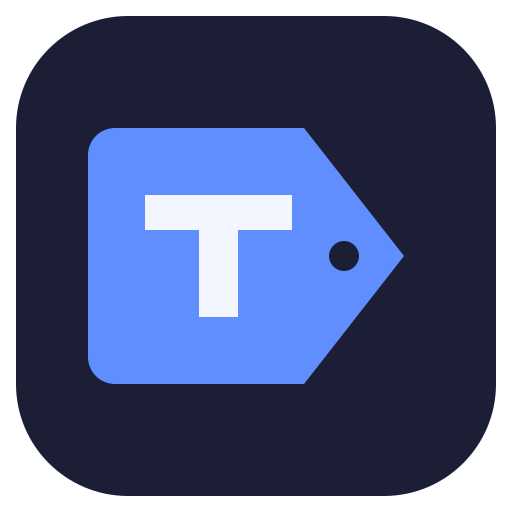

# Tagnetic



**Music tags, beautifully organised.**

A desktop music library editor built around a familiar table, quick previews and deliberate saving. Edit tags, tidy file names, find metadata and manage artwork, with a clear view of what will change before you Apply.

[Downloads](https://github.com/djhappyman/tagrex/releases) · [User guide](docs/guide/README.md) · [Roadmap](docs/ROADMAP.md) · [Report an issue](https://github.com/djhappyman/tagrex/issues)

Tagnetic is an independent project built on [TagRex](https://github.com/tagrex/tagrex), with its own interface and product direction. Shared improvements continue to be offered upstream.

> **In active development.** The interface and workflow are still being refined. Tagnetic is the new project name; existing builds and some documentation still use **TagRex Personal**. Published downloads are snapshots and may not include everything on `main`.

## Edit, preview, apply

1. **Choose your files.** Browse the table, select a range or narrow the library with filters.
2. **Make your changes.** Edit cells or use the inspector, online sources and transformation presets. Keep editing to build up staged changes.
3. **Review in Staged.** See the affected files with before-and-after values, then refine individual cells before saving.
4. **Apply when ready.** Save the staged changes to your files. Applied batches are recorded for Undo.

Previewing does not write changes to your music files. Apply is the save boundary.

## A workbench for your collection

- **Familiar editing.** Keyboard navigation, range selection, copy and paste, grouped rows and direct cell editing.
- **Useful filters.** Start with text, then add field conditions or filter by artwork status.
- **Reusable transformations.** Clean up spacing, change case and build your own rules, with automatic previews.
- **Metadata from several sources.** Search Discogs, MusicBrainz, Beatport, Bandcamp and Soundeo, or read tags from file names and text lists.
- **Artwork tools.** Browse covers, zoom, pan and rotate images in a dedicated picker.
- **A workspace that fits.** Adjustable panels, saved layouts, compact playback, four offline interface font choices and ten themes with light and dark appearances.

Performance is an ongoing focus: reducing repeated file reads, directory scans, artwork processing and interface updates. Responsive editing across libraries containing tens of thousands of files is a goal we measure, rather than a blanket performance claim.

## Download

Get builds from [this repository’s Releases](https://github.com/djhappyman/tagrex/releases). Earlier packages are named **TagRex Personal**. The original TagRex downloads provide its interface, not Tagnetic’s.

The release workflow targets:

| Platform | Packages |
| --- | --- |
| Windows x64 and ARM64 | `.exe` installer |
| macOS Apple Silicon and Intel | Universal `.dmg` |
| Linux x64 | `.deb`, `.rpm`, AppImage |
| Linux ARM64 | `.deb`, `.rpm` |

Use the assets actually attached to a release. Development artifacts are available from successful **Build and release** runs in [GitHub Actions](https://github.com/djhappyman/tagrex/actions/workflows/build-release.yml). Packaging checks do not replace hands-on testing in each native webview.

The app keeps its settings and Undo history separate from upstream TagRex. In-app updates are disabled, so it will not offer original-project updates over this fork. Current packages have no paid Windows signing or Apple notarization. See [build and release instructions](docs/BUILDING.md).

## Where we’re heading

- Faster, predictable editing and review on large libraries.
- Clearer previews, filters and feedback for bulk changes.
- Consistent controls, spacing and typography throughout the app.
- Better keyboard access, localization and native platform testing.

The [working roadmap](docs/ROADMAP.md) expands on these priorities. They describe the direction, not promised delivery dates.

## Development

Use Node 22.12+ and Rust compatible with the workspace minimum, plus the platform’s [Tauri prerequisites](https://v2.tauri.app/start/prerequisites/).

```sh
npm ci
npm run check
npm run test:unit
npm run build
cargo test --workspace --locked
npm run test:ui
```

See [development notes](docs/development.md) for native development and the local MCP bridge, and the [contribution workflow](docs/WORKFLOW.md) for verification and PR guidance. Test writes and Undo only on disposable audio fixtures.

## Built on TagRex

Tagnetic would not exist without [TagRex](https://github.com/tagrex/tagrex), created by [ThaVip3r](https://github.com/ThaVip3r) and its contributors. Its Rust/Tauri foundation, tagging engine, providers, player and recovery work made this project possible.

Original copyright notices and the [GPL-3.0-only licence](LICENSE) are retained. The [original README](docs/upstream/README.md) is preserved, and the inherited [user guide](docs/guide/README.md) remains useful for core operations, although interface details can differ.

Tagnetic is independently maintained and is not an official TagRex release. Shared backend fixes are offered to upstream `main`; eligible interface contributions go to its experimental `next` branch. See the [upstream contribution ledger](docs/UPSTREAM.md).

For Tagnetic issues and suggestions, use [this repository’s issue tracker](https://github.com/djhappyman/tagrex/issues).
